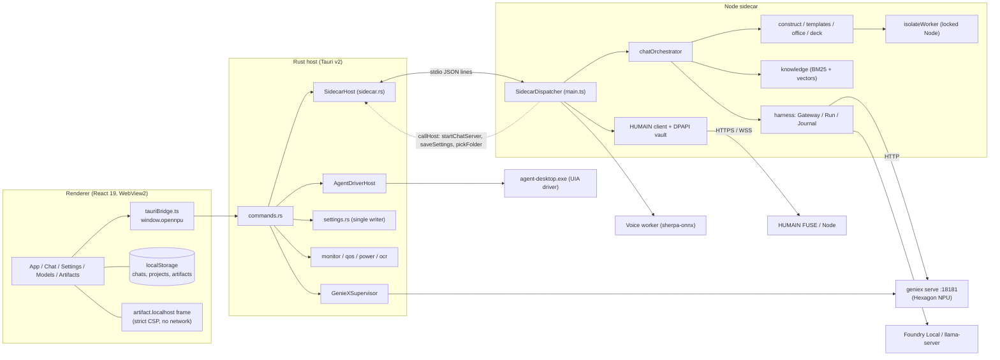
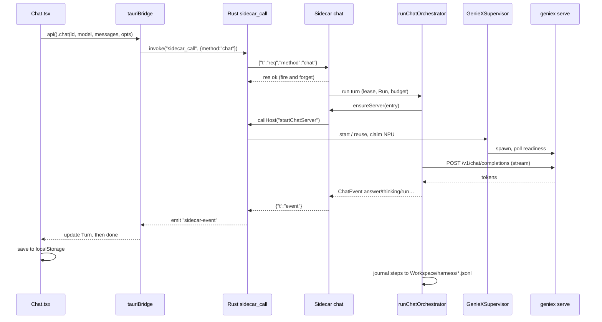
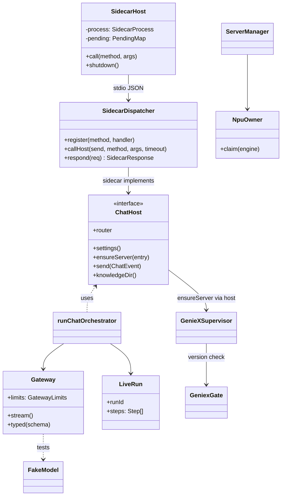
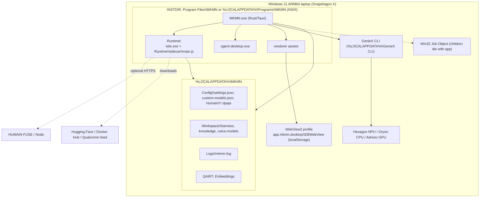
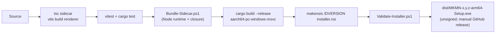

# MKMN AI — Developer Discovery & Onboarding Guide

> Generated 2026-11-22 from the `main` history at commit `5efc4ac` (v0.0.2).
> Scope: the whole repository (≈900 tracked files, ≈145k lines of TS/TSX/Rust/JS).
> All links are relative to the repository root.

---

## Table of contents

1. [README / instruction files summary](#1-readme--instruction-files-summary)
2. [Technology stack](#2-technology-stack)
3. [System overview and purpose](#3-system-overview-and-purpose)
4. [Project structure and reading recommendations](#4-project-structure-and-reading-recommendations)
5. [Key components](#5-key-components)
6. [Execution and data flows](#6-execution-and-data-flows)
7. [Dependencies and integrations](#7-dependencies-and-integrations)
8. [Diagrams](#8-diagrams)
9. [Testing](#9-testing)
10. [Error handling and logging](#10-error-handling-and-logging)
11. [Security considerations](#11-security-considerations)
12. [Other observations (build, deploy, tech debt)](#12-other-relevant-observations-including-builddeploy)

---

## 1. README / instruction files summary

### Files found

| File | Purpose |
| --- | --- |
| [README.md](README.md) | Product overview, install, build-from-source, folder map |
| [CONTRIBUTING.md](CONTRIBUTING.md) | PR checklist and the **rules the test suite enforces** (read this one carefully) |
| [docs/README.md](docs/README.md) | Index of all documentation |
| [docs/guide/user-guide.md](docs/guide/user-guide.md) | Every feature in plain words (end-user view) |
| [docs/design/](docs/design/) | Design notes: [construct-engine](docs/design/construct-engine.md), [computer-use](docs/design/computer-use.md), [data-at-rest](docs/design/data-at-rest.md), [design-prompt-budget](docs/design/design-prompt-budget.md), [doc-edit-copy](docs/design/doc-edit-copy.md), [blocks-design](docs/design/blocks-design.md), [BRAND](docs/design/BRAND.md), [ANIMATIONS](docs/design/ANIMATIONS.md) |
| [docs/research/](docs/research/) | NPU loading, "Dynamic" model, knowledge retrieval benchmarks |
| [docs/prompt-lab/](docs/prompt-lab/) | The prompt-lab tool and its prompt series |
| [docs/releases/](docs/releases/) | Per-release notes ([v0.0.2](docs/releases/RELEASE_NOTES_v0.0.2.md), [v0.0.1](docs/releases/RELEASE_NOTES_v0.0.1.md)) |
| Generated docs | [MKMN_FEATURE_TEST_MATRIX_0.0.2.md](docs/MKMN_FEATURE_TEST_MATRIX_0.0.2.md), [settings-inventory.md](docs/settings-inventory.md), [state-machines.md](docs/state-machines.md) |
| [THIRD_PARTY_NOTICES.md](THIRD_PARTY_NOTICES.md), [LICENSE](LICENSE) | MIT; derivative of [Open NPU](https://github.com/disposablecameraapp/Open-NPU) |

### Project overview (from README)

**MKMN AI** (مكمن, "reservoir") is a **local-first AI desktop workspace for Windows 11 ARM64 on Qualcomm Snapdragon X** laptops. It runs LLMs on the **Hexagon NPU** via Qualcomm **GenieX**, keeps chats and files on the PC, and optionally connects to **HUMAIN FUSE** and **HUMAIN Node** cloud APIs using the user's own API key. It is an independent project (not endorsed by HUMAIN/Qualcomm).

### Local setup (build from source)

Requirements: Snapdragon X laptop + Windows 11, **Node.js 24+ (ARM64)**, **pnpm 10.26.1**, **Rust 1.90+** with target `aarch64-pc-windows-msvc`, Visual Studio Build Tools (MSVC ARM64 + Win 11 SDK), **NSIS 3** (installer only).

```powershell
git clone https://github.com/zzahed/MKMN.git MKMN
cd MKMN
pnpm --ignore-workspace install --frozen-lockfile
pnpm rebuild esbuild
.\scripts\setup-arm64-libs.ps1 -Source "C:\path\to\arm64-libs"   # ARM64 .lib import libraries
pnpm typecheck
pnpm test
pnpm start      # builds the sidecar, then `tauri dev`
pnpm dist       # scripts\Build-Windows.ps1 -> dist\MKMN-<version>-arm64-Setup.exe
```

ARM64 import libraries are resolved by [src-tauri/build.rs](src-tauri/build.rs) from `src-tauri/native-sdk/lib`, `$MKMN_ARM64_LIBS\lib`, or `%USERPROFILE%\.arm64-libs\lib` (see [.cargo/config.toml](.cargo/config.toml)). If a state-machine test fails on Windows, set `git config core.autocrlf false` and re-checkout.

> There is a **browser preview mode** (`pnpm dev:renderer` + [src/renderer/mock.html](src/renderer/mock.html) / [mock-entry.ts](src/renderer/mock-entry.ts) / [mock.ts](src/renderer/mock.ts)) that mounts the same `App` with a stand-in bridge. Useful for UI work off-Windows. Opening `index.html` in a plain browser shows a "Windows desktop runtime required" card ([main.tsx](src/renderer/main.tsx)).

### Standards & conventions (from CONTRIBUTING, enforced by tests)

| # | Rule | Guard |
| --- | --- | --- |
| 1 | React hooks go **above** every early `return` | [tests/hooks.test.ts](tests/hooks.test.ts) |
| 2 | Sidecar imports no desktop-shell code; **stdout is protocol-only** (all `console.*` → stderr) | [src/sidecar/main.ts](src/sidecar/main.ts) top, [tests/sidecarProtocol.test.ts](tests/sidecarProtocol.test.ts) |
| 3 | Never guess an app path — use `mkmnPaths()` | [src/shared/paths.ts](src/shared/paths.ts), [tests/paths-contract.test.ts](tests/paths-contract.test.ts) |
| 4 | Every setting has **one default** in the schema | [src/shared/settingsSchema.ts](src/shared/settingsSchema.ts), [tests/settings-schema.test.ts](tests/settings-schema.test.ts) |
| 5 | English and Arabic only in UI text, comments, docs | [scripts/check-language.mjs](scripts/check-language.mjs), [tests/language.test.ts](tests/language.test.ts) |
| 6 | Model-written code never runs in the sidecar process (use `isolation()`) | [tests/isolation.test.ts](tests/isolation.test.ts) |
| 7 | No console window from any spawn (`windowsHide`) | [tests/console-hygiene.test.ts](tests/console-hygiene.test.ts) |
| 8 | Every GenieX inference path calls the version gate; every GenieX start releases Foundry Local first | [tests/geniex-gate.test.ts](tests/geniex-gate.test.ts), [tests/one-engine-guard.test.ts](tests/one-engine-guard.test.ts) |

### Contribution guidelines

- PRs target `main`. `pnpm typecheck`, `pnpm exec vitest run`, and `cargo check` (when Rust changed) must pass.
- A bug fix **starts with a failing regression test**.
- New command / sidecar method / Settings row / screen / script → regenerate the feature matrix: `node scripts/generate-feature-matrix.mjs --write`.
- After editing `settingsSchema.ts` or `stateMachines.json`: `node scripts/generate-settings-schema.mjs --write` and `node scripts/generate-state-machines.mjs`.
- Every prompt/instruction block must be registered in `INSTRUCTION_BLOCKS` ([src/core/prompts.ts](src/core/prompts.ts)) with a priority; [tests/prompt-budget.test.ts](tests/prompt-budget.test.ts) must pass.
- Releases: bump the version in **four places** — [package.json](package.json), [src-tauri/Cargo.toml](src-tauri/Cargo.toml), [src-tauri/Cargo.lock](src-tauri/Cargo.lock) (app entry), [src-tauri/tauri.conf.json](src-tauri/tauri.conf.json) — plus `ExpectedVersion` in [scripts/Live-Relaunch-Check.ps1](scripts/Live-Relaunch-Check.ps1). Checked by [tests/version.test.ts](tests/version.test.ts).

---

## 2. Technology stack

| Layer | Technology | Version (detected) | Evidence |
| --- | --- | --- | --- |
| Desktop shell | **Tauri v2** (Rust host + WebView2) | `tauri 2.12.5`, `@tauri-apps/cli ^2.12.4` | [src-tauri/Cargo.toml](src-tauri/Cargo.toml), [package.json](package.json) |
| Host language | **Rust**, edition 2024 | `rust-version = "1.90"` | [src-tauri/Cargo.toml](src-tauri/Cargo.toml) |
| Async runtime | Tokio (process, io, sync, time) | `1` | same |
| Windows APIs | `windows` / `windows-sys` crates (Job Objects, Power, UI Automation, OCR, DXCore, DWM…) | `0.62` / `0.61` | same |
| Logic language | **TypeScript** (strict, ES2022) | `^5.6.0` | [tsconfig.base.json](tsconfig.base.json) |
| Sidecar runtime | **Node.js** (plain, CommonJS build, bundled into the installer) | Node 24 (README/CI) | [tsconfig.sidecar.json](tsconfig.sidecar.json), [scripts/Bundle-Sidecar.ps1](scripts/Bundle-Sidecar.ps1) |
| UI framework | **React 19** | `^19.0.0` | [package.json](package.json) |
| UI bundler | **Vite 7** + `@vitejs/plugin-react` | `^7.0.0` | [vite.config.ts](vite.config.ts) |
| Visual page editor | `@measured/puck` | `^0.20.2` | [src/core/page/catalog.ts](src/core/page/catalog.ts), [PageEditor.tsx](src/renderer/PageEditor.tsx) |
| Rendering libs | Mermaid 11, KaTeX 0.19, PDF.js 6, Lucide icons, AOS / animate.css / countUp (vendored) | — | [package.json](package.json), [scripts/vendor-icons.js](scripts/vendor-icons.js), [scripts/vendor-anim.js](scripts/vendor-anim.js) |
| Local inference (NPU) | **Qualcomm GenieX CLI** (external, ≥ 0.11.0), QAIRT/QNN runtimes | — | [src/core/geniex.ts](src/core/geniex.ts), [src/core/geniexGate.ts](src/core/geniexGate.ts), [src-tauri/src/supervisor.rs](src-tauri/src/supervisor.rs) |
| Second engine | **Microsoft Foundry Local** (external) | — | [src/core/foundryHost.ts](src/core/foundryHost.ts) |
| CPU/GPU engine | llama.cpp `llama-server` (external) | — | [src/core/runtime.ts](src/core/runtime.ts) |
| Speech | `sherpa-onnx-node` (STT/TTS), separate worker | `1.13.8` | [src/voice/](src/voice/), [src/core/voiceService.ts](src/core/voiceService.ts) |
| Embeddings | `onnxruntime-node` + multilingual MiniLM (opt-in download) | `1.21.0` | [src/core/knowledge/embed.ts](src/core/knowledge/embed.ts) |
| Cloud | HUMAIN FUSE / Node (HTTPS REST + `ws` WebSocket realtime) | `ws ^8.23.0` | [src/core/humain.ts](src/core/humain.ts), [src/sidecar/humain.ts](src/sidecar/humain.ts) |
| JS parser | `acorn` (code checks) | `8.19.0` | [src/core/codecheck.ts](src/core/codecheck.ts) |
| Tests | **Vitest 5**, Testing Library, jsdom; `cargo test` | `^5.1.0` | [vitest.config.ts](vitest.config.ts) |
| Package manager | **pnpm 10.26.1** (`--ignore-workspace`), Cargo | — | [pnpm-lock.yaml](pnpm-lock.yaml), [.npmrc](.npmrc) |
| Installer | **NSIS 3** (custom script, not Tauri's bundler output) | — | [installer.nsi](installer.nsi) |
| Build scripts | PowerShell 5.1+ | — | [scripts/Build-Windows.ps1](scripts/Build-Windows.ps1) |
| CI | GitHub Actions on `windows-11-arm` (manual dispatch) | — | [.github/workflows/](.github/workflows/) |

**Databases:** none in the server sense. Persistence is **file-based** (JSON / JSONL files under `%LOCALAPPDATA%\MKMN`) plus **WebView2 `localStorage`** for chats/projects/artifacts. The knowledge index is a home-grown **BM25 index** (+ optional vector file) stored as JSON — see [§6.1](#61-database-schema-overview).

**Architecture style:** a **modular desktop monolith** with a **3-process topology** — Rust host (supervisor / native capabilities), Node **sidecar** (business logic, talked to over line-delimited JSON on stdio), and React **renderer** (WebView2). Core logic is written as pure, host-agnostic TypeScript with injected dependencies (the `ChatHost` port in [chatOrchestrator.ts](src/core/chatOrchestrator.ts) is a classic ports-and-adapters seam). Lifecycles are formalized as **state machines** declared in JSON and generated into both TS and Rust.

**Cloud platform:** none for hosting (the app is offline-capable). Optional SaaS: HUMAIN FUSE (`api.fuse.humainaic.com`) and HUMAIN Node (`api.node.humain.com`). Model sources: Hugging Face, Docker Hub `ai/` namespace, Qualcomm AI Hub.

**Containerization:** none (no Dockerfile/K8s). "Docker" in the code is the **Docker Hub public API** used as a model catalog ([src/core/docker.ts](src/core/docker.ts)).

---

## 3. System overview and purpose

### What it does and for whom

MKMN is an **evaluation & showcase workspace for AI PCs** (primarily HUMAIN's Snapdragon X2 Elite laptop). Target users: people evaluating on-device AI, and power users who want private, offline chat and document work. It shows *where* the work runs (live NPU/GPU/CPU meters) and *measures* models on the user's own machine.

### Problems solved

- Running LLMs **on the NPU** is hard (model formats, context limits, memory ceilings, driver/GenieX versions). MKMN handles discovery, install, load-setting ladders, placement verification and recovery.
- **Small models are weak at long tasks.** Much of the code exists to make 4B-class models produce reliable output by breaking work into short, checked steps (construction engine, templates, block languages, reviewers, menders).
- **Privacy**: local by default; cloud only on explicit choice per chat.

### Core functionalities

| Domain | Feature | Main code |
| --- | --- | --- |
| Model management | Catalog, Hugging Face / Docker Hub browse, install/uninstall via GenieX, Foundry Local, fit/verdict per PC | [catalog.ts](src/core/catalog.ts), [hf.ts](src/core/hf.ts), [browse.ts](src/core/browse.ts), [geniex.ts](src/core/geniex.ts), [foundryHost.ts](src/core/foundryHost.ts), [fit.ts](src/core/fit.ts) |
| Chat | Streaming chat, thinking effort, compaction of long chats, vision via describer models, sub-agents, web search | [chatOrchestrator.ts](src/core/chatOrchestrator.ts), [chat.ts](src/core/chat.ts), [compaction.ts](src/core/compaction.ts), [orchestrate.ts](src/core/orchestrate.ts) |
| Model routing ("Dynamic" packs Flash/Flux/Forge) | Sort a request into a task category → pick best installed model; tiny CPU **router** model resolves ambiguity | [dynamic.ts](src/core/dynamic.ts), [router.ts](src/core/router.ts) |
| Projects & knowledge | Project files → sections → BM25 (+vectors) retrieval with **citations** | [knowledge/](src/core/knowledge/), [cite.ts](src/core/cite.ts), [projects.ts](src/core/projects.ts) |
| Content creation | Real `.docx/.xlsx/.pptx` without Office; decks in steps; Word/Excel templates; websites | [office.ts](src/core/office.ts), [slides.ts](src/core/slides.ts), [deckBuild.ts](src/core/deckBuild.ts), [templates/](src/core/templates/) |
| Visuals | Charts (JSON), Mermaid diagrams, figure blocks, game engine | [chart.ts](src/core/chart.ts), [diagram.ts](src/core/diagram.ts), [blocks.ts](src/core/blocks.ts), [engine.ts](src/core/engine.ts) |
| App/game building | Construction engine: plan → units → checks → assemble; block-language pages (xblocks) | [construct/](src/core/construct/), [build.ts](src/core/build.ts), [xbuild.ts](src/core/xbuild.ts), [xblocks/](src/core/xblocks/) |
| Artifacts | Preview in isolated frame, versions, export, edit | [artifacts.ts](src/core/artifacts.ts), [versions.ts](src/core/versions.ts), [ArtifactView.tsx](src/renderer/ArtifactView.tsx) |
| Document edit | "Edit a copy" of a Word file with a propose/validate/apply loop | [docEdit.ts](src/core/docEdit.ts), [docEditRun.ts](src/sidecar/docEditRun.ts) |
| Voice | STT/TTS, live voice chat with VAD and barge-in | [voiceService.ts](src/core/voiceService.ts), [vad.ts](src/core/vad.ts), [voiceChat.ts](src/renderer/voiceChat.ts) |
| Computer Use | Drive **one** granted window via UI Automation; no keyboard; refuses consequential controls | [computerUse.ts](src/sidecar/computerUse.ts), [agent_driver.rs](src-tauri/src/agent_driver.rs), [agent-desktop.rs](src-tauri/src/bin/agent-desktop.rs) |
| Skills & scheduled tasks | Multi-step skills; cron-like tasks run when the NPU is free | [skills.ts](src/core/skills.ts), [scheduler.ts](src/core/scheduler.ts), [schedule.ts](src/core/schedule.ts) |
| Hardware & telemetry | Meters, battery, power/QoS (EcoQoS), NPU diagnostics/reset, benchmark, NPU load test | [monitor.rs](src-tauri/src/monitor.rs), [qos.rs](src-tauri/src/qos.rs), [bench.ts](src/core/bench.ts), [npuTest.ts](src/core/npuTest.ts) |
| Cloud (HUMAIN) | FUSE chat through the app pipeline; Node chat/speech/image/embedding/realtime console | [cloudChat.ts](src/core/cloudChat.ts), [sidecar/humain.ts](src/sidecar/humain.ts), [HumainSettings.tsx](src/renderer/HumainSettings.tsx) |
| Developer tools | Prompt lab, evals, benchmark export | [promptLab.ts](src/core/promptLab.ts), [harness/evals.ts](src/core/harness/evals.ts), [PromptLab.tsx](src/renderer/PromptLab.tsx) |

---

## 4. Project structure and reading recommendations

### Entry points

| Process | Entry | Notes |
| --- | --- | --- |
| Rust host | [src-tauri/src/main.rs](src-tauri/src/main.rs) → `mkmn_lib::run()` in [src-tauri/src/lib.rs#L171](src-tauri/src/lib.rs#L171) | Creates the window, registers commands ([L275](src-tauri/src/lib.rs#L275)), `setup` ([L317](src-tauri/src/lib.rs#L317)) manages `SidecarHost`, `AgentDriverHost`, tray, monitor loop |
| Node sidecar | [src/sidecar/main.ts](src/sidecar/main.ts) | Registers ~124 methods on a `SidecarDispatcher`, plus HUMAIN methods |
| Renderer | [src/renderer/index.html](src/renderer/index.html) → [main.tsx](src/renderer/main.tsx) → [App.tsx](src/renderer/App.tsx) | `setupTauriBridge()` installs `window.opennpu` |
| Voice worker | [src/voice/worker.ts](src/voice/worker.ts) | Separate Node process for sherpa-onnx |
| Isolated code runner | [src/sidecar/isolateWorker.ts](src/sidecar/isolateWorker.ts) | Node permission-model process for model-written code |
| Computer Use driver | [src-tauri/src/bin/agent-desktop.rs](src-tauri/src/bin/agent-desktop.rs) | Separate pinned binary |
| Headless CLI | [src/sidecar/headless.ts](src/sidecar/headless.ts) | One chat turn via argv, for acceptance tests |

### Folder organization

```
MKMN/
├── src-tauri/              Rust host (Tauri v2)
│   ├── src/lib.rs          app bootstrap, command registry
│   ├── src/commands.rs     #[tauri::command] handlers (incl. sidecar_call)
│   ├── src/sidecar.rs      spawns & supervises the Node sidecar (stdio JSON)
│   ├── src/supervisor.rs   GenieX model-server supervisor (largest Rust file)
│   ├── src/settings*.rs    the ONE writer of settings.json (+ generated defaults)
│   ├── src/monitor.rs, qos.rs, power.rs, battery.rs, npudiag.rs, npu_recovery.rs …
│   ├── src/agent_*.rs      Computer Use driver host + wire contract
│   ├── capabilities/default.json   Tauri permission set
│   └── tauri.conf.json     CSP, bundle config
├── src/
│   ├── core/               host-agnostic business logic (≈200 modules)
│   │   ├── harness/        model gateway, runs/steps, journal, budget, identity, fake models
│   │   ├── construct/      general "construction engine" for programs
│   │   ├── knowledge/      BM25 + vector retrieval over project files
│   │   ├── templates/      Word/Excel/site templates
│   │   ├── page/           block-based web pages (Puck schema, themes, icons)
│   │   ├── xblocks/        browser runtime of the block language (bundled → xblocks.generated.ts)
│   │   └── shelved/        unused code kept deliberately (imports forbidden)
│   ├── sidecar/            Node process: dispatcher, HUMAIN, Computer Use loop, isolation
│   ├── renderer/           React UI (Chat, Settings, Models, Artifacts, …), Tauri bridge, store
│   ├── shared/             types, API contract, settings schema, paths, state machines
│   └── voice/              voice worker
├── tests/                  ≈270 Vitest files + fixtures
├── scripts/                build (PowerShell), generators (.mjs), smoke tests (.js)
├── docs/                   design, research, guide, generated inventories
├── crates/                 patched vendored crates (tauri-winres, vswhom-sys) for ARM64
├── build/                  icons, brand SVGs
└── installer.nsi           NSIS installer script
```

Conventions worth knowing:

- **`*.generated.ts` / `settings_defaults.rs` are generated** — never edit by hand ([stateMachines.generated.ts](src/shared/stateMachines.generated.ts), [xblocks.generated.ts](src/core/xblocks.generated.ts), [icons.generated.ts](src/core/page/icons.generated.ts), [vendor.generated.ts](src/core/page/vendor.generated.ts), [settings_defaults.rs](src-tauri/src/settings_defaults.rs)).
- `src/core` modules are **pure or dependency-injected**; Node-only modules are not imported by the renderer (the renderer tsconfig includes `src/core`, so keep browser-safe modules free of `fs`).
- The global API object is still called **`window.opennpu`** / `OpenNpuApi` (heritage from Open NPU).
- Every module starts with a long explanatory block comment — read it first; they are high quality.

### Configuration

| File | What it controls | Critical? |
| --- | --- | --- |
| [src/shared/settingsSchema.ts](src/shared/settingsSchema.ts) | **Every** settings key, default, scope, group, label, "applies when" | ★★★ |
| `%LOCALAPPDATA%\MKMN\Config\settings.json` (runtime) | User settings, written **only** by the Rust host ([settings.rs](src-tauri/src/settings.rs)) | ★★★ |
| [src/shared/paths.ts](src/shared/paths.ts) / [paths.rs](src-tauri/src/paths.rs) | On-disk layout (data, config, workspace, logs, QAIRT, embeddings) | ★★★ |
| [src/shared/stateMachines.json](src/shared/stateMachines.json) | Lifecycles shared by Rust & TS (server, voice, run, bench, npuOwner…) | ★★ |
| [src-tauri/tauri.conf.json](src-tauri/tauri.conf.json) | CSP, identifier `app.mkmn.desktop`, build hooks | ★★ |
| [src-tauri/capabilities/default.json](src-tauri/capabilities/default.json) | Tauri permissions (fs deny-default, opener http/https) | ★★ |
| [src/shared/consequentialControls.json](src/shared/consequentialControls.json) | Words Computer Use refuses to click (EN/AR) | ★★ |
| [src/shared/geniexVersionLines.json](src/shared/geniexVersionLines.json), [geniexGate.ts](src/core/geniexGate.ts) | Minimum GenieX version | ★★ |
| [src/core/dynamic-data.json](src/core/dynamic-data.json), [scores.json](src/core/scores.json), [bench-candidates.json](src/core/bench-candidates.json) | Model routing data and shipped benchmark scores | ★ |
| [vite.config.ts](vite.config.ts), [vitest.config.ts](vitest.config.ts), `tsconfig.*.json` | Build/test config (note the `vm` → [vm-shim.ts](src/renderer/vm-shim.ts) alias) | ★ |
| Env vars | `MKMN_ARM64_LIBS` (build), `MKMN_REQUIRE_SIDECAR=1` (tests require built sidecar) | ★ |

No `.env` files are used; secrets are not in config (see §11).

### Recommended reading order

1. [README.md](README.md) → [CONTRIBUTING.md](CONTRIBUTING.md) → [docs/README.md](docs/README.md) → [docs/design/data-at-rest.md](docs/design/data-at-rest.md).
2. **Process wiring:** [src/sidecar/protocol.ts](src/sidecar/protocol.ts) (115 lines, the whole IPC contract) → [src-tauri/src/sidecar.rs](src-tauri/src/sidecar.rs) (top) → [`sidecar_call`](src-tauri/src/commands.rs#L470) → [`sidecarCall`](src/renderer/tauriBridge.ts#L57) in the bridge.
3. **Contracts:** [src/shared/api.ts](src/shared/api.ts) (`OpenNpuApi`), [src/shared/types.ts](src/shared/types.ts) (`ChatEvent`, `CatalogEntry`, `Settings`), [src/shared/paths.ts](src/shared/paths.ts), [docs/state-machines.md](docs/state-machines.md).
4. **The chat path:** [`register("chat")`](src/sidecar/main.ts#L1725) → [`runChatOrchestrator`](src/core/chatOrchestrator.ts#L636) → [harness/gateway.ts](src/core/harness/gateway.ts) → [chat.ts](src/core/chat.ts).
5. **Harness kernel:** [harness/run.ts](src/core/harness/run.ts), [settle.ts](src/core/harness/settle.ts), [turn.ts](src/core/harness/turn.ts), [journal.ts](src/core/harness/journal.ts), [testing.ts](src/core/harness/testing.ts).
6. **NPU/model serving:** [src/core/server.ts](src/core/server.ts), [npuOwner.ts](src/core/npuOwner.ts), [lease.ts](src/core/lease.ts), [src-tauri/src/supervisor.rs](src-tauri/src/supervisor.rs), and [docs/research/npu-load-research.md](docs/research/npu-load-research.md) *before touching loading*.
7. **Routing:** [dynamic.ts](src/core/dynamic.ts), [router.ts](src/core/router.ts).
8. **Knowledge:** [knowledge/store.ts](src/core/knowledge/store.ts), [retrieve.ts](src/core/knowledge/retrieve.ts), [cite.ts](src/core/cite.ts).
9. **UI:** [App.tsx](src/renderer/App.tsx), [Chat.tsx](src/renderer/Chat.tsx), [store.ts](src/renderer/store.ts), [SettingsView.tsx](src/renderer/SettingsView.tsx).
10. Feature deep-dives as needed: [construct-engine.md](docs/design/construct-engine.md), [computer-use.md](docs/design/computer-use.md), [design-prompt-budget.md](docs/design/design-prompt-budget.md).

---

## 5. Key components

### 5.1 Rust host — `mkmn_lib::run` / commands

[src-tauri/src/lib.rs](src-tauri/src/lib.rs) builds the hidden main window (fits it to the monitor work area in physical pixels, pins the WebView2 data dir, installs the artifact-frame navigation guard), registers ~40 commands and starts supervisors. Responsibilities: window/tray, **single instance** ([single_instance.rs](src-tauri/src/single_instance.rs)), **Job Object** so children die with the app ([job_object.rs](src-tauri/src/job_object.rs)), coordinated shutdown ([shutdown.rs](src-tauri/src/shutdown.rs)), settings writer, meters, OCR (Windows.Media.Ocr), QoS/EcoQoS.

```rust
// src-tauri/src/lib.rs
.invoke_handler(tauri::generate_handler![
    commands::preload_model,
    commands::start_server,
    commands::get_settings,
    commands::save_settings_cmd,
    commands::get_meters_cmd,
    commands::sidecar_call,          // generic gateway to the Node sidecar
    commands::agent_begin_run_cmd,   // Computer Use grant
    /* … */
])
```

### 5.2 Sidecar host (Rust) — `SidecarHost`

[src-tauri/src/sidecar.rs](src-tauri/src/sidecar.rs) spawns the bundled `node.exe Runtime\sidecar\main.js`, forwards webview calls, answers sidecar→host requests (folder picker, `startChatServer`, `saveSettings`, …) and re-emits sidecar events as the Tauri event `sidecar-event`. It tracks a **generation** counter so a dead sidecar only fails *its own* pending calls; calls time out after 600 s.

```rust
// src-tauri/src/commands.rs#L470
#[tauri::command]
pub async fn sidecar_call(method: String, args: Value,
    sidecar: tauri::State<'_, crate::sidecar::SidecarHost>) -> Result<Value, String> {
    refuse_work_while_shutting_down()?;
    sidecar.call(&method, args).await
}
```

### 5.3 Sidecar protocol & dispatcher

[src/sidecar/protocol.ts](src/sidecar/protocol.ts) — one JSON object per line; `req` / `res` / `event`, bidirectional.

```ts
export interface SidecarRequest  { t: "req"; id: string; method: string; args: unknown[] }
export interface SidecarResponse { t: "res"; id: string; ok: boolean; result?: unknown; error?: string }
export interface SidecarEvent    { t: "event"; name: string; payload: unknown }

export class SidecarDispatcher {
  register(method: string, handler: SidecarHandler): void { this.methods.set(method, handler); }
  callHost(send, method, args = [], timeoutMs = 600_000): Promise<unknown> { /* … */ }
  async respond(m: SidecarRequest): Promise<SidecarResponse> { /* never throws */ }
}
```

### 5.4 Sidecar main — method registry

[src/sidecar/main.ts](src/sidecar/main.ts) (≈3.4k lines) wires everything: settings (read file, write **via host**), catalog, installs (`install`, `uninstall`, `installDynamic`), voice (`transcribe`, `speak`), chat (`chat`, `abortChat`, `compactChat`), router, setup, benchmark, Foundry, NPU test/reset, knowledge (`knowledgeBuild`), code running (`runCode`, `runCommand`), Computer Use (`agentRun`), tasks (`saveTask`, `runTask`), `forgetConversation`, `appShutdown`. It forces all `console.*` to stderr and installs the isolation runner at startup:

```ts
setIsolation(lockedNodeRunner());
for (const m of ["log", "info", "warn", "error", "debug"] as const) {
  console[m] = (...a: unknown[]) => { try { process.stderr.write(format(...a) + "\n"); } catch {} };
}
```

### 5.5 Renderer bridge — `window.opennpu`

[src/renderer/tauriBridge.ts](src/renderer/tauriBridge.ts) implements `OpenNpuApi` ([shared/api.ts](src/shared/api.ts)) by mapping each method either to a direct Tauri command (`invoke("get_settings")`) or to `sidecar_call`, and sorts `sidecar-event`s into listener sets (chat events, install progress, voice…). UI code calls `api()` from [src/renderer/api.ts](src/renderer/api.ts).

```ts
async function sidecarCall<T = unknown>(method: string, ...args: unknown[]): Promise<T> {
  return invoke<T>("sidecar_call", { method, args });
}
```

### 5.6 Chat orchestrator

[`runChatOrchestrator`](src/core/chatOrchestrator.ts#L636) is the heart of the product. It is host-agnostic: all side effects come through the injected **`ChatHost`** interface (`ensureServer`, `send`, `router`, `figure`, `checkArtifact`, `knowledgeDir`, `embedder`, …). Per turn it: acquires the NPU **runtime lease**, opens a harness **Run** and **turn budget**, parses `/tool` commands, sorts Dynamic requests, describes images, ensures a server, folds old messages, retrieves knowledge, routes to builds/decks/templates/charts or plain chat, runs the reviewer, and finally sends `done` or `error`.

```ts
export interface ChatHost {
  settings(): Settings;
  ensureServer(entry: CatalogEntry, o?: { signal?: AbortSignal; retryModelLoad?: boolean }): Promise<Served>;
  send(ev: ChatEvent): void;
  router?: { sort(text, installed, lean?): Promise<RouterResult | null>; yesNo(text, ask): Promise<boolean | null>; /* … */ };
  knowledgeDir?(): string | null;
  /* … */
}
```

### 5.7 Harness (gateway, runs, settle, journal, budget)

[src/core/harness/](src/core/harness/) — the one path every model call takes.

| Module | Role |
| --- | --- |
| [gateway.ts](src/core/harness/gateway.ts) `Gateway` | Single door to a model server: identity injection, 45 s stall watchdog, per-run call/token limits, typed-output ladder (`response_format` → JSON repair → `key: value`) |
| [run.ts](src/core/harness/run.ts) `createLiveRun` | A run = async generator of settled `Step`s; app-driven loop |
| [settle.ts](src/core/harness/settle.ts) `settle` | Only writer of a run's final verdict (`done/unresolved/failed/cancelled`) |
| [turn.ts](src/core/harness/turn.ts) | One cap on **all** model calls of a user-visible turn |
| [journal.ts](src/core/harness/journal.ts) | Append-only JSONL at `Workspace\harness\<runId>.jsonl` |
| [offload.ts](src/core/harness/offload.ts) | Large payloads go to files beside the journal |
| [identity.ts](src/core/harness/identity.ts) | The assistant's identity ("MKMN AI") and its guard |
| [forget.ts](src/core/harness/forget.ts) | Deleting a chat deletes its journals |
| [testing.ts](src/core/harness/testing.ts) `FakeModel` | Test double replacing the server fetch |

```ts
export class GatewayLimitError extends Error {
  constructor(readonly kind: "calls" | "tokens", readonly limits: GatewayLimits) {
    super(kind === "calls"
      ? `the run's model-call limit is reached (${limits.maxCalls} calls)`
      : `the run's output-token limit is reached (${limits.maxOutputTokens} tokens)`);
  }
}
```

### 5.8 Model serving: GenieX, Foundry, llama.cpp, NPU ownership

- [src-tauri/src/supervisor.rs](src-tauri/src/supervisor.rs) `GenieXSupervisor` — owns `geniex.exe serve` on `127.0.0.1:18181`, readiness polling, log tail, NPU vs CPU-fallback verification, memory estimates ([memory_estimator.rs](src-tauri/src/memory_estimator.rs)), power mode.
- [src/core/server.ts](src/core/server.ts) `ServerManager` — generic TS server manager (GenieX, router, llama-server), restarts, `adoptExisting` for the shared router.
- [src/core/npuOwner.ts](src/core/npuOwner.ts) `NpuOwner` — state machine `free | geniex | foundry`; every start calls `claim`, which releases the other engine first.
- [src/core/lease.ts](src/core/lease.ts) `runtimeLease` — chat vs bench vs task mutual exclusion on the NPU.
- [src/core/geniexGate.ts](src/core/geniexGate.ts) `GeniexGate` — minimum-version check on every inference path.

### 5.9 Dynamic packs & router

[dynamic.ts](src/core/dynamic.ts): [`sortRequest`](src/core/dynamic.ts#L244) categorizes by rules (web page, Python, translation, proof…); [`pickModel`](src/core/dynamic.ts#L357) picks from the pack's lanes among installed models. When the rules hesitate, [router.ts](src/core/router.ts) asks a **very small model on the CPU** yes/no questions, with a circuit breaker ([`RouterBreaker`](src/core/router.ts#L112)) and vote settling.

### 5.10 Knowledge retrieval

[knowledge/index.ts](src/core/knowledge/index.ts) cuts files into sections (pages, headings, slides, rows); [store.ts](src/core/knowledge/store.ts) keeps a per-project BM25 index on disk ([`openKnowledgeIndex`](src/core/knowledge/store.ts#L225), [`buildKnowledgeIndexNow`](src/core/knowledge/store.ts#L387)), rebuilt only when the files' hash changes; [vectors.ts](src/core/knowledge/vectors.ts) + [embed.ts](src/core/knowledge/embed.ts) add optional multilingual vectors; [retrieve.ts](src/core/knowledge/retrieve.ts) packs sections as `<section source="N">` blocks; [cite.ts](src/core/cite.ts) validates citations and cited figures.

### 5.11 Construction engine & content builders

- [construct/pipeline.ts](src/core/construct/pipeline.ts): builds any program in checked steps — task list → wiring → units → code fixes ([fixes.ts](src/core/construct/fixes.ts), [mend.ts](src/core/construct/mend.ts), [bind.ts](src/core/construct/bind.ts)) → sandboxed examples ([sandbox.ts](src/core/construct/sandbox.ts)) → assemble by code ([assemble.ts](src/core/construct/assemble.ts)) → scenario judge ([scene.ts](src/core/construct/scene.ts)). Design: [construct-engine.md](docs/design/construct-engine.md).
- Office: [office.ts](src/core/office.ts) (one plain-text form per kind ↔ OOXML), [zip.ts](src/core/zip.ts), [xml.ts](src/core/xml.ts), [sheet.ts](src/core/sheet.ts) (formula evaluator), [slides.ts](src/core/slides.ts) (one layout, two renderers: .pptx and HTML preview).

### 5.12 Settings schema & single writer

[settingsSchema.ts](src/shared/settingsSchema.ts) declares every key once; [`readSetting`](src/shared/settingsSchema.ts#L890) / `readBool` / `readNum` always resolve the schema default. The sidecar writes through [settingsWriter.ts](src/core/settingsWriter.ts) → host `saveSettings` → [settings.rs](src-tauri/src/settings.rs) (read‑merge‑write under `SETTINGS_WRITE_LOCK`).

### 5.13 State machines

[stateMachines.json](src/shared/stateMachines.json) declares 13 machines — `server`, `voice`, `build`, `run`, `setup`, `preload`, `bench`, `knowledgeIndex`, `agentRun`, `npuOwner`, `modelVerdict`, `agentGrant`, `geniexProbe` — generated into [stateMachines.generated.ts](src/shared/stateMachines.generated.ts) and consumed by Rust ([state_machine.rs](src-tauri/src/state_machine.rs)). `nextState()` validates transitions.

### 5.14 Renderer UI

[App.tsx](src/renderer/App.tsx) (shell, navigation), [Chat.tsx](src/renderer/Chat.tsx) (composer, streaming turns, cards), [SettingsView.tsx](src/renderer/SettingsView.tsx), [Models.tsx](src/renderer/Models.tsx), [ArtifactView.tsx](src/renderer/ArtifactView.tsx), [Projects.tsx](src/renderer/Projects.tsx), [computerUse.tsx](src/renderer/computerUse.tsx), [HumainSettings.tsx](src/renderer/HumainSettings.tsx), [BenchDashboard.tsx](src/renderer/BenchDashboard.tsx). State is plain React + [store.ts](src/renderer/store.ts) (localStorage-backed conversations) — no Redux/Zustand.

### Component interdependencies (summary)

`renderer` → (Tauri IPC) → `Rust commands` → (`sidecar_call`, stdio JSON) → `sidecar/main.ts` → `core/*` (orchestrator → harness → chat transport → HTTP to `127.0.0.1:18181` GenieX/Foundry/llama). Sidecar calls back the host for anything native (start model server, dialogs, settings write, NPU recovery, open files).

---

## 6. Execution and data flows

### 6.1 Flow A — Sending a local chat message

1. **UI** ([Chat.tsx](src/renderer/Chat.tsx)) appends a pending `Turn` to the conversation in [store.ts](src/renderer/store.ts) and calls `api().chat(id, modelId, messages, opts)` ([tauriBridge.ts#L995](src/renderer/tauriBridge.ts#L995)).
2. Bridge → `invoke("sidecar_call", {method:"chat", args})` → Rust [`sidecar_call`](src-tauri/src/commands.rs#L470) → `SidecarHost.call` writes a `req` line to the sidecar's stdin.
3. Sidecar [`register("chat")`](src/sidecar/main.ts#L1725) answers immediately (fire-and-forget) and starts [`runChatOrchestrator`](src/core/chatOrchestrator.ts#L636).
4. Orchestrator: **lease** (`runtimeLease.acquire("chat")`, else "The NPU is busy") → **Run + turn budget** → tool commands → Dynamic sort/router → image description → `host.ensureServer(entry)`.
5. `ensureServer` in the sidecar calls back **`startChatServer`** on the host ([main.ts#L1360](src/sidecar/main.ts#L1360)); Rust `GenieXSupervisor` claims the NPU, spawns/reuses `geniex serve`, verifies readiness.
6. Orchestrator compacts old turns if needed, retrieves knowledge, assembles the system prompt from budgeted instruction blocks ([prompts.ts](src/core/prompts.ts)), then streams via the **Gateway** → [chat.ts](src/core/chat.ts) (OpenAI-style streaming, thinking split, loop detection).
7. Each `ChatEvent` (`thinking`, `answer`, `run`, `build`, `review`, `notice`, `memo`, `done`, `error`…) goes `host.send` → sidecar `event` line → Rust emits `sidecar-event` → bridge listeners → React state.
8. Post-processing: charts settled, reviewer/code check on artifacts, citation guard, `done` with stats; steps journaled to `Workspace\harness\*.jsonl`.
9. UI persists the conversation in `localStorage` (`opennpu.conversations`).

### 6.2 Flow B — HUMAIN FUSE chat

Same entry, but `modelId === CLOUD_CHAT_ID` ([main.ts#L1728](src/sidecar/main.ts#L1728)): optional FUSE web search via its Responses API (results injected as a system message, links listed under the answer), then the **same orchestrator pipeline** with FUSE served as an OpenAI-compatible endpoint ([cloudChat.ts](src/core/cloudChat.ts)). The key is read from the DPAPI vault for each request ([humainVault.ts](src/sidecar/humainVault.ts)); requests go through [`humainRequest`](src/core/humain.ts), which pins the origin and refuses redirects.

### 6.3 Flow C — Installing a model

`Models` screen → `install` (sidecar) → [geniex.ts](src/core/geniex.ts) `pullModel` (GenieX CLI pulls from Hugging Face / Docker Hub / AI Hub, with progress events) → disk check → installed list refresh → `unknownModelCheck` / load-failure records per GenieX version ([loadFailures.ts](src/core/loadFailures.ts)) → verdict shown in UI.

### 6.4 Flow D — Project knowledge Q&A

Project files live in the renderer and **travel with the request**. In the orchestrator: if files exceed the knowledge budget → `openKnowledgeIndex(dir, projectId, files)` (load or rebuild on hash change) → BM25 (+vectors if installed) → top sections packed in frames (`inFrame`, [frames.ts](src/core/frames.ts)) labelled as *information, not instructions* → answer → `cite.ts` drops invented `[source N]` markers and flags figures absent from the cited passage.

### 6.5 Flow E — Computer Use

Renderer picks a window → `agent_begin_run_cmd` (host records **one grant**) → sidecar `agentRun` → [`runAgentLoop`](src/sidecar/computerUse.ts#L340): observe UIA tree → model proposes one action → validate (consequential words, grant) → host driver executes → re-observe/verify → bounded loop → verdict. No keyboard, no screenshots. See [computer-use.md](docs/design/computer-use.md).

### Where data lives / how it propagates

| Data | Written by | Read by |
| --- | --- | --- |
| Settings | Rust host only | Host, sidecar (file read), renderer (`get_settings`) |
| Chats, projects, artifacts, versions | Renderer (`localStorage`) | Renderer; sent to sidecar per request |
| Run journals / offload | Sidecar (harness) | Sidecar (recall, forget) |
| Knowledge index / vectors | Sidecar | Sidecar |
| Scheduled tasks | Sidecar `JsonStore` (`tasks.json`) | Sidecar scheduler |
| Model files | GenieX / Foundry / voice installer | Engines |
| HUMAIN keys | Sidecar vault (DPAPI) | Sidecar only (never sent to renderer) |

### 6.1 Database schema overview

There is no SQL/NoSQL database. The "entities" are JSON documents:

| Store | Shape (main types) | Defined in |
| --- | --- | --- |
| `settings.json` | `Settings` – flat key/value per schema | [types.ts](src/shared/types.ts), [settingsSchema.ts](src/shared/settingsSchema.ts) |
| `custom-models.json`, `hardware.json` | `CatalogEntry[]`, `HardwareProfile` | [types.ts](src/shared/types.ts) |
| Conversations | `Conversation { id, title, turns: Turn[], memo?, projectId? }` | [renderer/store.ts](src/renderer/store.ts) |
| Projects | `Project { id, files, instructions, folder? }` | [types.ts](src/shared/types.ts), [Projects.tsx](src/renderer/Projects.tsx) |
| Artifacts / versions | `Artifact`, version tree with diffs | [artifacts.ts](src/core/artifacts.ts), [versions.ts](src/core/versions.ts), [versionBook.ts](src/core/versionBook.ts) |
| Harness journal (JSONL) | run header (pipeline, conversationId) + `JournalStep` lines | [journal.ts](src/core/harness/journal.ts) |
| Knowledge index | sections + BM25 postings + files hash | [knowledge/store.ts](src/core/knowledge/store.ts) |
| Tasks | `ScheduledTask` | [types.ts](src/shared/types.ts), [library.ts](src/core/library.ts) |
| Model evidence / bench | `EvidenceRecord`, bench runs | [model_manifest.rs](src-tauri/src/model_manifest.rs), [benchStore.ts](src/core/benchStore.ts) |

Relationships: **Project 1—N Conversation** (by `projectId`), **Conversation 1—N Run journal** (by `conversationId` in the run header, used by `forgetConversation`), **Project 1—1 Knowledge index**, **Artifact 1—N Version**.

---

## 7. Dependencies and integrations

### 7.1 Main libraries

| Dependency | Role | Where used |
| --- | --- | --- |
| `tauri` + plugins (`log`, `opener`, `fs`, `dialog`, `notification`, `process`) | Desktop shell, IPC, native dialogs, logging | [lib.rs](src-tauri/src/lib.rs), [capabilities/default.json](src-tauri/capabilities/default.json) |
| `tokio` | Async process supervision | [sidecar.rs](src-tauri/src/sidecar.rs), [supervisor.rs](src-tauri/src/supervisor.rs) |
| `reqwest` | Host HTTP (health probes) | [supervisor.rs](src-tauri/src/supervisor.rs) |
| `sha2` | Download verification | [commands.rs `verify_sha256_cmd`](src-tauri/src/commands.rs#L421) |
| `webview2-com` | Artifact-frame navigation guard | [artifact_frame.rs](src-tauri/src/artifact_frame.rs) |
| `windows`, `windows-sys` | UIA, OCR, Job Objects, power, registry, DXCore | many `src-tauri/src/*.rs` |
| `react`, `react-dom` | UI | [src/renderer](src/renderer) |
| `@measured/puck` | Visual editor for block pages | [PageEditor.tsx](src/renderer/PageEditor.tsx) |
| `mermaid`, `katex`, `pdfjs-dist` | Diagrams, math, PDF text/scan rendering | [DiagramBlock.tsx](src/renderer/DiagramBlock.tsx), [Tex.tsx](src/renderer/Tex.tsx), [renderer/pdf.ts](src/renderer/pdf.ts) |
| `sherpa-onnx-node` | STT/TTS | [voice/backend.ts](src/voice/backend.ts) |
| `onnxruntime-node` | Embedding model | [knowledge/embed.ts](src/core/knowledge/embed.ts) |
| `ws` | HUMAIN Node realtime WebSocket | [sidecar/humain.ts](src/sidecar/humain.ts) |
| `acorn` | JS parsing for code checks | [codecheck.ts](src/core/codecheck.ts) |
| `lucide-static`, `aos`, `animate.css`, `countup.js` | Vendored into generated TS for generated pages | [scripts/vendor-icons.js](scripts/vendor-icons.js), [scripts/vendor-anim.js](scripts/vendor-anim.js) |

Notable *absence*: no zod (custom schema in [harness/schema.ts](src/core/harness/schema.ts)), no state-management lib, no ORM, no HTTP framework. Many things (zip, XML, markdown, syntax highlighting) are hand-written to avoid dependencies.

### 7.2 External integrations

| Integration | Protocol | Module(s) |
| --- | --- | --- |
| **Qualcomm GenieX CLI** | Spawned process + OpenAI-compatible HTTP on `127.0.0.1:18181` | [geniex.ts](src/core/geniex.ts), [server.ts](src/core/server.ts), [supervisor.rs](src-tauri/src/supervisor.rs), [geniexRelease.ts](src/core/geniexRelease.ts) (release feed `index.json` / manifests with SHA-256) |
| **QAIRT runtimes** | Files pinned by host | [qairt_runtime.rs](src-tauri/src/qairt_runtime.rs), [qairt.ts](src/core/qairt.ts) |
| **Microsoft Foundry Local** | `foundry` CLI + local HTTP | [foundryHost.ts](src/core/foundryHost.ts), [foundry.ts](src/core/foundry.ts) |
| **llama.cpp** | `llama-server` HTTP | [runtime.ts](src/core/runtime.ts) |
| **HUMAIN FUSE** | HTTPS REST (OpenAI-style + Responses API + Anthropic-style `/v1/messages`) | [core/humain.ts](src/core/humain.ts), [cloudChat.ts](src/core/cloudChat.ts), [sidecar/humain.ts](src/sidecar/humain.ts) |
| **HUMAIN Node** | HTTPS REST + WSS `/v1/realtime` | [sidecar/humain.ts](src/sidecar/humain.ts) |
| **Hugging Face** | HTTPS API (model search, GGUF metadata via range reads) | [hf.ts](src/core/hf.ts), [gguf.ts](src/core/gguf.ts), [browse.ts](src/core/browse.ts) |
| **Docker Hub** (`ai/` namespace) | Public REST | [docker.ts](src/core/docker.ts) |
| **Wikimedia Commons** | REST | [wikimedia.ts](src/core/wikimedia.ts) |
| Web search | via orchestrator tools / FUSE | [websearch.ts](src/core/websearch.ts), [orchestrate.ts](src/core/orchestrate.ts) |
| **winget** | Install/update runtimes from a fixed list | [requirements.ts](src/core/requirements.ts) |
| **LibreOffice** (optional) | Convert legacy `.doc/.xls/.ppt` | [officeConvert.ts](src/core/officeConvert.ts) |
| **PowerShell / WMI** | Hardware, battery, NPU counters, DPAPI | [hardware.ts](src/core/hardware.ts), [battery.ts](src/core/battery.ts), [perf.ts](src/core/perf.ts), [humainVault.ts](src/sidecar/humainVault.ts) |

### 7.3 API documentation

MKMN exposes **no network API**. Its internal APIs are documented by:

- **TypeScript contracts**: [`OpenNpuApi`](src/shared/api.ts) (renderer ↔ app), [`ChatEvent`](src/shared/types.ts) (streaming events), [`SidecarMessage`](src/sidecar/protocol.ts) (wire format), [agent.ts](src/shared/agent.ts) ↔ [agent_wire.rs](src-tauri/src/agent_wire.rs) (Computer Use).
- **Generated inventory**: [MKMN_FEATURE_TEST_MATRIX_0.0.2.md](docs/MKMN_FEATURE_TEST_MATRIX_0.0.2.md) lists every Tauri command, sidecar method, setting, screen and script with its covering test (`node scripts/generate-feature-matrix.mjs --write`).
- Extensive JSDoc/Rust doc comments in every module. No Swagger/OpenAPI (none needed).

---

## 8. Diagrams

### 8.1 Component diagram



### 8.2 Data flow — one local chat turn



### 8.3 Class diagram (key types)



### 8.4 Deployment diagram



### 8.5 Build / release pipeline



---

## 9. Testing

| Aspect | Details |
| --- | --- |
| Location | [tests/](tests/) (~270 `*.test.ts(x)`), fixtures in [tests/fixtures/](tests/fixtures/) (eval datasets, knowledge docs, judged HTML pages), shelved tests in [tests/shelved/](tests/shelved/) |
| Framework | **Vitest 5** (node env default; `.tsx` component tests declare `@vitest-environment jsdom`), **Testing Library** (react, user-event) |
| Rust | ~250 `#[test]` functions inline in `src-tauri/src/*.rs` (`cargo test`) |
| Network guard | [tests/setup-model-guard.ts](tests/setup-model-guard.ts) rejects every real `fetch`; model calls use [`FakeModel`](src/core/harness/testing.ts#L89) or stubs; [tests/fake-geniex.js](tests/fake-geniex.js) fakes the CLI |
| Unit tests | Pure logic: `dynamic`, `router`, `chart`, `office`, `sheet`, `cite`, `compaction`, `zip`, `versions`… |
| Integration | `integration.test.ts`, `core-chat-orchestrator.test.ts`, `bridge-*.test.ts`, `sidecar-*.test.ts` (live sidecar when built; required with `MKMN_REQUIRE_SIDECAR=1`) |
| Architecture/"rule" tests | `hooks`, `language`, `isolation`, `console-hygiene`, `geniex-gate`, `one-engine-guard`, `settings-schema`, `state-machines`, `prompt-budget`, `version`, `feature-matrix`, `paths-contract`, `gateway-only`, `settle-only` |
| Evals | [harness/evals.ts](src/core/harness/evals.ts) with frozen datasets in `tests/fixtures/evals` (generated by `eval-datasets.test.ts`) |
| Smoke / E2E | [scripts/smoke-sidecar*.js](scripts/) drive the built sidecar; [scripts/Live-Relaunch-Check.ps1](scripts/Live-Relaunch-Check.ps1), [Check-After-Close.ps1](scripts/Check-After-Close.ps1), [Check-Installed-Sidecar.ps1](scripts/Check-Installed-Sidecar.ps1), [Validate-Installer.ps1](scripts/Validate-Installer.ps1) for installed-app checks; [scripts/xblocks-smoke/](scripts/xblocks-smoke/) for block runtimes |

Run locally:

```powershell
pnpm test                         # vitest run (all)
pnpm exec vitest run tests/router.test.ts   # one file
pnpm run build:sidecar; $env:MKMN_REQUIRE_SIDECAR="1"; pnpm test   # include live-sidecar tests
cargo test --manifest-path src-tauri\Cargo.toml
node scripts/check-language.mjs
```

**CI:** [.github/workflows/](.github/workflows/) — "MKMN Windows ARM64 verification", **`workflow_dispatch` only** (not on push/PR), on `windows-11-arm`: install → typecheck → licenses → build renderer & sidecar → `pnpm test` with live sidecar → bundle sidecar → `cargo build --release` → `cargo test --release` → NSIS → validate installer → upload artifact. It never publishes releases.

> Note: tests were not executed while preparing this document (the container is Linux; the project targets Windows ARM64).

---

## 10. Error handling and logging

### Error handling patterns

- **Friendly errors:** raw engine output is mapped through regex rules to `FriendlyError { id, title, fix, raw }` in [src/core/errors.ts](src/core/errors.ts) (`friendly()`, `isNoise()` drops harmless lines). `ModelStartError` carries one. The UI renders `title` + `fix`.

  ```ts
  { id: "humain-key", test: /HUMAIN (Fuse|Node): HTTP 401|invalid_api_key|missing_api_key/i,
    title: "The HUMAIN key was refused",
    fix: "The key is missing, revoked or wrong. Save a new key in Settings, HUMAIN." }
  ```
- **IPC errors:** `SidecarDispatcher.respond` never throws — exceptions become `{ ok:false, error }`; unknown methods get "Unknown sidecar method". The host fails pending calls when a sidecar generation dies and respawns it.
- **Chat errors** are streamed as `ChatEvent { type: "error" }`; budget limits (`GatewayLimitError`, `GatewayTurnLimitError`) end a turn honestly with `done`.
- **Run verdicts:** every harness run ends in `settle()` → `done | unresolved | failed | cancelled`.
- **Abort:** `AbortController` per chat (`abortChat`), [abortable.ts](src/core/abortable.ts) `raceAbort`.
- **Watchdogs:** 45 s stall detection in the Gateway, server health probes and a single recovery (`recoverServer`), NPU recovery/reset ([npu_recovery.rs](src-tauri/src/npu_recovery.rs), [npuReset.ts](src/core/npuReset.ts)).
- **React:** [ErrorBoundary.tsx](src/renderer/ErrorBoundary.tsx) shows the stack with "Reload" / "Clear saved chats and reload".
- **"Honest numbers":** meters show `N/A` instead of fabricated values (tested in `design-honesty.test.ts`, `engine-compare-honest.test.tsx`).

### Logging

| Where | Mechanism | File |
| --- | --- | --- |
| Rust host | `log` crate + `tauri-plugin-log` (levels tuned in `log_levels()` in [lib.rs](src-tauri/src/lib.rs)); 2 MB rotation, 3 kept | `%LOCALAPPDATA%\app.mkmn.desktop\logs\MKMN.log` |
| Rust lifecycle | `paths::append_log(kind, line)` / `startup_log(stage, detail)` ([paths.rs](src-tauri/src/paths.rs)) with elapsed ms | `%LOCALAPPDATA%\MKMN\Logs\mkmn.log`, GenieX log |
| Sidecar | `console.*` redirected to **stderr**, captured by the host | host log |
| Harness | Structured JSONL journal per run (steps, usage, errors) | `Workspace\harness\*.jsonl` |
| Build | `dist\build-logs\build.result.json` + per-command logs | [BuildResult.ps1](scripts/lib/BuildResult.ps1) |

Format is plain text lines (stage + detail); the journal is the structured record. Deliberate privacy: task text and window contents of Computer Use, and document words, are kept out of logs. **No external monitoring** (no Sentry/Datadog/telemetry) — the app "collects no usage data".

---

## 11. Security considerations

| Area | Mechanism | Where |
| --- | --- | --- |
| Secrets | HUMAIN API keys encrypted with **Windows DPAPI (CurrentUser)** via a PowerShell subprocess; stored as `Config\Humain\{fuse,node}.dpapi`; never returned to the renderer | [humainVault.ts](src/sidecar/humainVault.ts), [settings-secrets.test.ts](tests/settings-secrets.test.ts) |
| Cloud request hardening | Origin pinned, path must start with `/`, `redirect: "error"`, 120 s timeout, error codes sanitized | [`humainRequest`](src/core/humain.ts) |
| SSRF / downloads | `pinnedGet` checks the resolved address **inside the connection's lookup** (no DNS rebinding), https-only, refuses private/IPv6-mapped ranges; generic downloader https-only | [netGuard.ts](src/core/netGuard.ts), [download.ts](src/core/download.ts) |
| Supply chain of runtimes | GenieX installer verified (Windows signature verdict + SHA-256 from Qualcomm manifest); voice models pinned SHA-256 + size, staged extraction refusing links; embedding model pinned revision | [installerTrust.ts](src/core/installerTrust.ts), [geniexRelease.ts](src/core/geniexRelease.ts), [voiceInstall.ts](src/core/voiceInstall.ts), [vectorModel.ts](src/core/knowledge/vectorModel.ts) |
| Executing model-written code | Fresh Node process with the **permission model** (read app code only, no write/child processes/workers/addons), bare env, 60 s limit | [isolate.ts](src/core/isolate.ts), [isolation.ts](src/sidecar/isolation.ts), [isolateWorker.ts](src/sidecar/isolateWorker.ts) |
| Generated page preview | Separate `artifact.localhost` origin with its own strict CSP (also sent as header), all network blocked, navigation away cancelled by a WebView2 guard | [artifact_frame.rs](src-tauri/src/artifact_frame.rs), [artifact-frame.html](src/renderer/public/artifact-frame.html) |
| App CSP | `default-src 'self'; script-src 'self'; connect-src 'self' ipc: http://127.0.0.1:* …` | [tauri.conf.json](src-tauri/tauri.conf.json) |
| Tauri permissions | `fs:deny-default` + only read/write file; opener restricted to http/https | [capabilities/default.json](src-tauri/capabilities/default.json) |
| Prompt injection | Document text neutralized inside the app's frame tags; knowledge labelled as information, not instructions; citation guard | [frames.ts](src/core/frames.ts), [prompt-injection.test.ts](tests/prompt-injection.test.ts), [cite.ts](src/core/cite.ts) |
| Computer Use | One window grant held by the host; accessibility-only, **no keyboard path**; consequential controls (EN/AR) refused by sidecar **and** native driver; unnamed controls refused | [computerUse.ts](src/sidecar/computerUse.ts), [consequential.ts](src/shared/consequential.ts), [agent_wire.rs](src-tauri/src/agent_wire.rs) |
| Approval of runs | Approval prompts must show the full code/command they authorize | [approval.ts](src/core/approval.ts) |
| Folder access | Model-given paths resolved inside the project folder; `..`, other drives, outward links refused | [folderRun.ts](src/core/folderRun.ts) |
| Process hygiene | Win32 Job Object, single instance, no console windows, elevated-owner guard | [job_object.rs](src-tauri/src/job_object.rs), [single_instance.rs](src-tauri/src/single_instance.rs) |
| Local endpoint auth | Covered by [endpoint-auth.test.ts](tests/endpoint-auth.test.ts) | — |

Authentication/authorization in the web sense does not apply (single-user desktop app). Known gaps are documented honestly in [data-at-rest.md](docs/design/data-at-rest.md): chats/journals are **not encrypted** by MKMN (rely on BitLocker), no retention period, project deletion leaves its knowledge index, installer is **unsigned**.

---

## 12. Other relevant observations (including build/deploy)

### Build & deploy files

| File | What it tells you |
| --- | --- |
| [scripts/Build-Windows.ps1](scripts/Build-Windows.ps1) | The canonical release build (`pnpm dist`): TS → Rust → bundled Node → NSIS; every native command run through [NativeCommand.ps1](scripts/lib/NativeCommand.ps1) judged by exit code; summary in `build.result.json`; `-SkipTests` switch |
| [scripts/Bundle-Sidecar.ps1](scripts/Bundle-Sidecar.ps1), [stage-sidecar-closure.cjs](scripts/stage-sidecar-closure.cjs) | Ships a private Node runtime + the sidecar's dependency closure (`Runtime\sidecar\main.js`) |
| [installer.nsi](installer.nsi) | Custom NSIS installer; version **must** be passed (`/DVERSION`); `RequestExecutionLevel highest`; uninstall keeps user data |
| [scripts/setup-arm64-libs.ps1](scripts/setup-arm64-libs.ps1), [src-tauri/build.rs](src-tauri/build.rs), [crates/](crates/) | ARM64 MSVC import-lib plumbing and patched crates (`tauri-winres`, `vswhom-sys`) |
| [scripts/licenses.cjs](scripts/licenses.cjs) | Regenerates `THIRD_PARTY_LICENSES.txt` |
| Generators | [generate-settings-schema.mjs](scripts/generate-settings-schema.mjs), [generate-state-machines.mjs](scripts/generate-state-machines.mjs), [generate-feature-matrix.mjs](scripts/generate-feature-matrix.mjs), [build-xblocks.js](scripts/build-xblocks.js), [vendor-icons.js](scripts/vendor-icons.js), [vendor-anim.js](scripts/vendor-anim.js), [generate-brand-assets.mjs](scripts/generate-brand-assets.mjs) |
| Workflow | Manual-dispatch Windows ARM64 verification (see §9) |

Deployment model: **manual GitHub Releases of an unsigned NSIS installer**; the README publishes the SHA-256. **No auto-update** — [updater.ts](src/core/updater.ts) keeps the IPC contract but has no transport by design.

### Things a new developer should know

- **Very large modules:** [supervisor.rs](src-tauri/src/supervisor.rs) (~4k lines), [sidecar/main.ts](src/sidecar/main.ts) (~3.4k), [SettingsView.tsx](src/renderer/SettingsView.tsx) (~2.1k), [build.ts](src/core/build.ts) (~1.8k), [Chat.tsx](src/renderer/Chat.tsx) (~1.7k), [tauriBridge.ts](src/renderer/tauriBridge.ts) (~1.7k), [chatOrchestrator.ts](src/core/chatOrchestrator.ts) (~1.6k), [benchRunner.ts](src/core/benchRunner.ts). They are the main maintainability debt; `runChatOrchestrator` alone is ~950 lines.
- **Small-model-first design:** prompts are budgeted ([prompts.ts](src/core/prompts.ts), [design-prompt-budget.md](docs/design/design-prompt-budget.md)); models describe (JSON charts, Mermaid, block pages, game specs) and **code renders/validates**. When something fails, the answer is usually "add a deterministic fixer/check", not "a longer prompt". Never size instructions from the user message.
- **One NPU, one model at a time:** respect `runtimeLease`, `NpuOwner.claim`, the scheduler's "not while chatting" rule, and the one-engine guard.
- **Single sources of truth** are a recurring pattern: one settings default, one path layout, one settings writer, one gateway, one settle, one state-machine registry, one consequential-word list. Rule tests (`gateway-only`, `settle-only`, …) scan the source to enforce them — search the tests when a change seems "blocked".
- **Generated files:** edit the source (`settingsSchema.ts`, `stateMachines.json`, `xblocks/*.js`) and rerun the generator; tests compare generated output.
- **Shelved code:** [src/core/shelved/](src/core/shelved/) and [tests/shelved/](tests/shelved/) are kept intentionally and must not be imported.
- **Naming heritage:** `window.opennpu`, `OpenNpuApi`, `opennpu.conversations` come from the Open NPU fork; keep them unless migrating storage keys deliberately (saved chats depend on them).
- **Comment style:** long, plain-English "why" comments, often citing a measured incident. Keep that style; the language test rejects non-English/Arabic text.
- **CI quirk:** the upload step also lists `desktop/MKMN-App/dist/...` — a leftover path from an older layout (harmless because `dist/...` matches; `if-no-files-found: error` still applies).
- **Data-at-rest open items** (owner decisions): encryption of chats, retention, deleting a project's knowledge index.
- **Explicit TODO/FIXME markers:** none found in source; open issues are tracked in docs (release notes, data-at-rest "Not covered yet").
- **Performance notes:** Vite splits `react`, `puck`, `pdfjs`, `katex` chunks; Lucide icon table loaded lazily ([iconTable.ts](src/core/page/iconTable.ts)); predictive model preload while typing ([preloadController.ts](src/renderer/preloadController.ts)); router runs on CPU to keep the NPU for the chat model; EcoQoS/QoS tiers for background work ([qos.rs](src-tauri/src/qos.rs)).

---

*End of document.*
