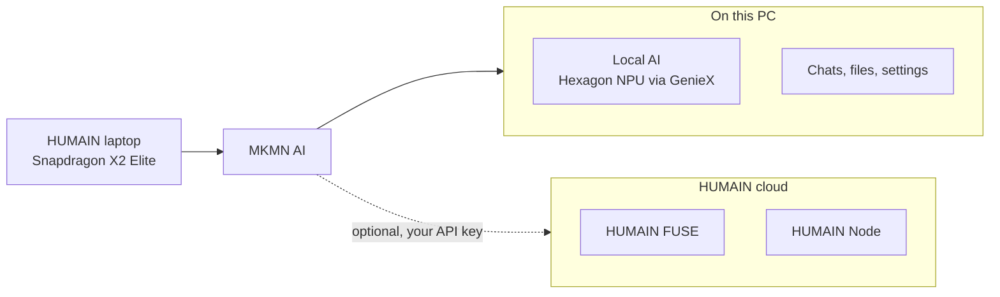

<div align="center">

<picture>
  <source media="(prefers-color-scheme: dark)" srcset="build/mkmn-wordmark-ai-dark.svg">
  
</picture>

# MKMN AI | مكمن

### Your Private Intelligence Reservoir.

**Designed for HUMAIN. Powered by Snapdragon X2 Elite. Connected to Saudi AI.**

[](https://github.com/zzahed/MKMN/releases/latest)


[](LICENSE)

</div>

**Works only on Snapdragon X laptops with Windows 11 (check: Settings → System → About).**
MKMN AI is an independent project: it is not affiliated with HUMAIN or Qualcomm,
and they do not develop, sponsor or endorse it.

Release status: v0.0.2 (latest published stable; [notes](docs/releases/RELEASE_NOTES_v0.0.2.md))

Release candidate: v0.0.3-rc.1 ([candidate notes](docs/releases/RELEASE_NOTES_v0.0.3-rc.1.md)). Source preparation in progress; no candidate installer has been published yet. Continue using the v0.0.2 release for installations until a tested candidate asset is available.

MKMN AI is a personal AI workspace built to explore and demonstrate what
HUMAIN's Snapdragon X2 Elite laptop can do. It runs AI models directly on the
laptop's NPU, keeps your chats and files on your PC, and, when you choose,
connects to **HUMAIN FUSE** and **HUMAIN Node**: private local intelligence and
Saudi AI services in one place.

<br>

## Built to Explore the Power of HUMAIN AI PCs

MKMN was developed and tested with the HUMAIN laptop as its primary platform.
It is an evaluation and demonstration tool for the AI PC, not just a chat window.

| | |
| :--- | :--- |
| **Snapdragon X2 Elite** | Our reference machine. Every model MKMN recommends was load-tested on Snapdragon X hardware. |
| **Hexagon NPU acceleration** | Models run on the Qualcomm NPU through Qualcomm GenieX. Each model is labelled **NPU**, **Hybrid** or **CPU**. |
| **AI on the laptop** | Once a model is installed, chat and document work run on the PC, offline if you like. No remote server is needed for local tasks. |
| **See where the work runs** | Live meters for NPU, GPU, CPU and memory show how each workload uses the chip. |
| **Measure it yourself** | A built-in benchmark records each model's speed on your own machine. |

> MKMN also runs on other Snapdragon X laptops with Windows 11. No benchmark
> figures are claimed here; MKMN measures on your device and shows the result.

<br>

## Three Ways to Experience Intelligence

Local AI is the default. HUMAIN FUSE and HUMAIN Node are optional and use your
own HUMAIN API key. You choose where each chat runs.

<table>
<tr>
<th width="33%">MKMN Local AI</th>
<th width="33%">HUMAIN FUSE</th>
<th width="33%">HUMAIN Node</th>
</tr>
<tr valign="top">
<td>

- Runs on the laptop's NPU
- Works offline after setup
- Chats and files stay on your PC
- Document analysis and content creation
- No API key needed

</td>
<td>

- HUMAIN's model and API platform
- Runs MKMN's full pipeline: files, charts, project knowledge
- Web search with cited sources
- Adjustable thinking effort, where supported

</td>
<td>

- HUMAIN Node's hosted AI services
- Choice of models and chat APIs
- Speech, image, embedding and realtime APIs through the built-in console
- A further path for connected work

</td>
</tr>
<tr>
<td><b>Processing:</b> this PC</td>
<td><b>Processing:</b> HUMAIN cloud</td>
<td><b>Processing:</b> HUMAIN cloud</td>
</tr>
</table>

FUSE and Node come from HUMAIN, part of Saudi Arabia's growing AI ecosystem.
When you pick a cloud provider, that chat's messages and attached content are
sent to that provider. Where the provider hosts and processes data is set by
HUMAIN's own terms, not by MKMN. API keys are stored on your PC, protected by
your Windows account (DPAPI).

<br>

## Why MKMN AI?

- **Private by default.** Local chats are processed and stored on your PC. MKMN collects no usage data.
- **Built for the NPU.** Models are picked and loaded to make good use of the Snapdragon AI engine.
- **Smart model packs.** Flash, Flux and Forge packs send each request to the model best at that job.
- **Answers you can check.** Document answers quote the file and page they came from.
- **Real office files.** Word, Excel and PowerPoint, made without Microsoft Office.
- **Local and cloud, one app.** Switch between your laptop and HUMAIN per chat.
- **Honest numbers.** Meters show "N/A" instead of a fake value when a reading is missing.

<br>

## Experience the Possibilities

| Try this | What happens |
| :--- | :--- |
| Chat with a local model | A private conversation, on the NPU, with no internet needed. |
| Ask about your documents | Answers come with a reference to the file and passage. |
| "Make a presentation about…" | A real `.pptx`, `.docx` or `.xlsx` with charts and working formulas. |
| Ask for a chart or diagram | It appears right in the chat. |
| Build a small app or game | MKMN writes it and tests it before you see it. |
| Talk instead of typing | Voice chat, with spoken replies. |
| Let MKMN help in a window | It can click and fill in fields in one window you choose. It has no keyboard and refuses buttons such as "Send", "Delete" or "Confirm". |
| Write in Arabic or English | Chat and documents work in both. The interface itself is in English. |

<br>

## Architecture



Solid lines stay on the laptop. Dotted lines go over the internet, and only the
provider you select receives that chat's data. Model downloads and optional web
features also use the internet and tell you so.

<br>

## Get Started

**You need:** a Snapdragon X laptop, Windows 11 (build 22000 or newer), and an
internet connection the first time to download a model.

1. Download `MKMN-<version>-arm64-Setup.exe` from the
   [latest release](https://github.com/zzahed/MKMN/releases/latest).
2. Run it. The installer is not signed, so Windows may say "Windows protected
   your PC". If you trust the file, click **More info**, then **Run anyway**.
   On a work PC, ask your IT team first.
3. Open MKMN and follow the setup. It asks before it downloads Qualcomm GenieX
   (0.11.0 or newer) and any model.
4. Go to **Settings → Models**, install a model and click **Use**.
5. Optional: add a HUMAIN key in **Settings → Cloud Intelligence**.

v0.0.2 installer SHA-256:
`64c3028df47abfc2c75ef1c6c34baf78388e7dde49bcfb2e8ef50b67a2b5e9a7`.
MKMN does not update itself; install a new release to update. Uninstalling
keeps your chats and settings (`%APPDATA%\MKMN`, `%LOCALAPPDATA%\MKMN`).

<details>
<summary><b>Build from source (developers)</b></summary>

<br>

On a Snapdragon X laptop with Windows 11, install Node.js 26+ (ARM64),
pnpm 10.26.1, Rust 1.100.0 (pinned in `rust-toolchain.toml`; rustup installs it) with the `aarch64-pc-windows-msvc` target, Visual
Studio Build Tools (MSVC ARM64 + Windows 11 SDK), and NSIS 3 for the installer.

```powershell
git clone https://github.com/zzahed/MKMN.git MKMN
cd MKMN
pnpm --ignore-workspace install --frozen-lockfile
pnpm rebuild esbuild
.\scripts\setup-arm64-libs.ps1 -Source "C:\path\to\arm64-libs"
pnpm typecheck
pnpm test
pnpm start
pnpm dist
```

The ARM64 `.lib` folder comes from the Windows SDK (`Lib\<version>\um\arm64`,
`Lib\<version>\ucrt\arm64`) and MSVC (`VC\Tools\MSVC\<version>\lib\arm64`);
you can also place it in `%USERPROFILE%\.arm64-libs\` or point
`MKMN_ARM64_LIBS` at it. `pnpm dist` runs `scripts\Build-Windows.ps1` and writes
`dist\MKMN-<version>-arm64-Setup.exe` (logs in `dist\build-logs`). If a
state-machine test fails on Windows, run `git config core.autocrlf false` and
check the files out again.

To build only the installer by hand, after `pnpm dist` has built the app once,
pass the version from `package.json`:

```powershell
makensis /DVERSION=0.0.3-rc.1 installer.nsi
```

| Folder | Contents |
| --- | --- |
| `src/core` | Main logic |
| `src/sidecar` | Background Node process |
| `src/renderer` | App window (React) |
| `src/shared` | Shared types and settings |
| `src-tauri` | Rust host: window, tray, model servers |
| `tests`, `scripts`, `docs` | Tests, build scripts, documentation |

</details>

<br>

## Explore Further

- [User guide](docs/guide/user-guide.md): every feature in plain words
- [Words and common questions](docs/guide/faq.md): NPU, GenieX, FUSE and more; offline use, privacy, a model that won't load
- [UI work without a Snapdragon laptop](CONTRIBUTING.md#ui-work-without-a-snapdragon-laptop): the browser preview with made-up data
- [Documentation index](docs/README.md): design notes, research and test matrix
- [Release notes](docs/RELEASE-NOTES.md) · [Latest release](https://github.com/zzahed/MKMN/releases/latest)
- [What is stored on your PC](docs/design/data-at-rest.md)
- [Contributing](CONTRIBUTING.md) · [Brand guide](docs/design/BRAND.md)

<br>

## About MKMN

MKMN (pronounced *Makman*) comes from مكمن, the Arabic word for an oil
reservoir: something valuable held safely beneath the surface. MKMN treats your
PC the same way, as a reservoir of knowledge and intelligence waiting to be
unlocked.

<br>

## Project Information

MKMN AI is an **independent project** (see the note at the top of this page).
It was built to test and showcase HUMAIN's AI laptop and to connect to HUMAIN's
public APIs. Product names belong to their owners.

Released under the [MIT license](LICENSE). MKMN is based on
[Open NPU](https://github.com/disposablecameraapp/Open-NPU) (MIT), whose notice
is kept in `LICENSE`. Other components are listed in
[THIRD_PARTY_NOTICES.md](THIRD_PARTY_NOTICES.md) and `THIRD_PARTY_LICENSES.txt`.
GenieX, the NPU driver, Foundry Local and the AI models are not part of this
project and keep their own licenses.

<div align="center">
<sub>Your Knowledge. Your Device. Your Control.</sub>
</div>
